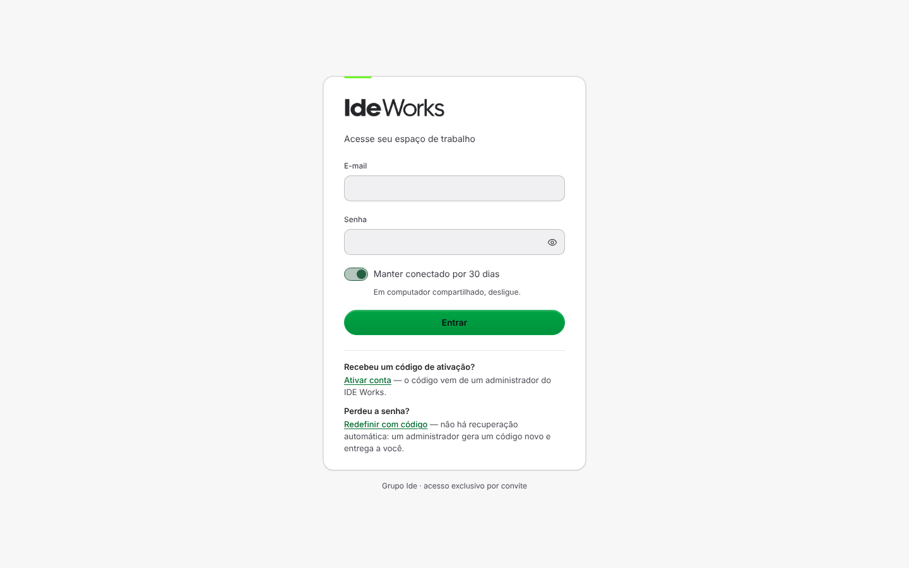

# 3. Rodar no computador

No fim deste tutorial o IdeWorks abre em `http://localhost:8080`, ligado ao banco que você
criou no Supabase.

Ele roda em **duas partes**, cada uma num terminal:

| Parte | Comando | Porta | O que é |
|---|---|---|---|
| A API | `npm run dev:api` | 8787 | O Worker da Cloudflare rodando no seu computador, falando com o Supabase |
| O site | `npm run dev` | 8080 | As telas (React). Tudo que vai para `/api` ele repassa para a 8787 |

## Passo 1: baixar o código

```bash
git clone https://github.com/wesleysbl/ide-works-base.git
cd ide-works-base
```

> Vai mexer no código e quer guardar a sua versão? Use **Fork** no GitHub e clone o seu
> fork em vez deste endereço.

## Passo 2: instalar as dependências

```bash
nvm use        # escolhe o Node 24 (pelo arquivo .nvmrc); sem nvm, confira node -v
npm install
```

Leva um ou dois minutos. Se aparecerem avisos (`npm warn`), pode ignorar; erro (`npm error`)
não. Veja [Problemas comuns](08-problemas-comuns.md) se der erro.

## Passo 3: conferir que está tudo inteiro

```bash
npm test
```

Roda mais de 6.700 testes, **sem internet e sem banco** (o banco é simulado). Leva de 3 a 6
minutos, conforme o computador. O fim deve dizer algo como:

```
 Test Files  324 passed | 7 skipped (331)
      Tests  6762 passed | 7 todo (6769)
```

## Passo 4: o arquivo `.env`

```bash
cp .env.example .env
```

Abra o `.env` no editor e preencha com os valores que você anotou no
[tutorial 2, passo 5](02-configurar-o-supabase.md#passo-5-anotar-as-chaves):

```ini
IDEWORKS_PUBLIC_DB_SCHEMA=ideworks
IDEWORKS_PUBLIC_SUPABASE_URL=https://abcdefghijklmnopqrst.supabase.co
IDEWORKS_PUBLIC_SUPABASE_ANON_KEY=eyJhbGciOi...            # a chave anon
IDEWORKS_SERVER_DB_USER=ideworks_app
IDEWORKS_SERVER_DB_PASSWORD=a-senha-que-voce-inventou       # do papel ideworks_app
IDEWORKS_SERVER_DB_HOST=aws-0-sa-east-1.pooler.supabase.com # o host do Transaction pooler
IDEWORKS_SERVER_SUPABASE_SERVICE_KEY=eyJhbGciOi...          # a chave service_role
```

`IDEWORKS_TEST_ACCOUNT_PASSWORD` pode ficar vazio.

## Passo 5: o arquivo `.dev.vars`

É lido pela API (o `wrangler dev`). Tem os segredos que só o servidor enxerga.

```bash
cp .dev.vars.example .dev.vars
```

Preencha:

- `IDEWORKS_SERVER_SUPABASE_SERVICE_KEY`: a mesma chave `service_role` do `.env`.
- `IDEWORKS_APPROVAL_LINK_KEY`: uma chave aleatória. Gere com:

  ```bash
  node -e "console.log(require('crypto').randomBytes(32).toString('base64'))"
  ```

As linhas da Meta e do Dropbox ficam vazias por enquanto (ver [tutorial 7](07-integracoes.md)).

## Passo 6: o `wrangler.toml`

A API lê as configurações públicas do arquivo `wrangler.toml`. Abra e troque, em `[vars]`:

```toml
IDEWORKS_PUBLIC_SUPABASE_URL = "https://abcdefghijklmnopqrst.supabase.co"
IDEWORKS_PUBLIC_SUPABASE_ANON_KEY = "eyJhbGciOi..."
```

São as mesmas do `.env`, e não são segredo (a chave `anon` vai no navegador de qualquer
jeito). Os outros campos do `wrangler.toml` (Hyperdrive, KV, domínio) só importam na hora
de publicar, no [tutorial 5](05-publicar-na-cloudflare.md).

## Passo 7: ligar

Terminal 1:

```bash
npm run dev:api
```

Ele mostra o código do seu projeto e o papel `ideworks_app` e, em seguida,
`Ready on http://localhost:8787`. Deixe aberto.

Terminal 2:

```bash
npm run dev
```

Abra **http://localhost:8080**.



Entre com o e-mail e a senha da conta que você criou no Supabase (tutorial 2, passo 3).
Você vai cair no **Painel**, ainda vazio. O [tutorial 4](04-primeiros-passos.md) mostra como
preencher.

> **Atalho:** `npm run dev:tudo` sobe os dois no mesmo terminal.

## Conferir que a API fala com o banco

Com a API ligada, abra **http://localhost:8787/api/health**. Deve aparecer:

```json
{"ok":true,"schema":"ideworks","projeto":"abcdefghijklmnopqrst"}
```

Se a tela de entrada recusar a senha ou ficar carregando, veja
[Problemas comuns](08-problemas-comuns.md).

---

Anterior: [2. Configurar o Supabase](02-configurar-o-supabase.md) ·
Próximo: [4. Primeiros passos no sistema](04-primeiros-passos.md)
