# 4. Primeiros passos no sistema

O banco começa vazio. Esta é a ordem que dá menos retrabalho para montar a sua agência
dentro do IdeWorks. As imagens usam dados fictícios.

## 1. Catálogos: planos, unidades e etiquetas

Menu da conta (canto de baixo da barra lateral) → **Catálogos**.

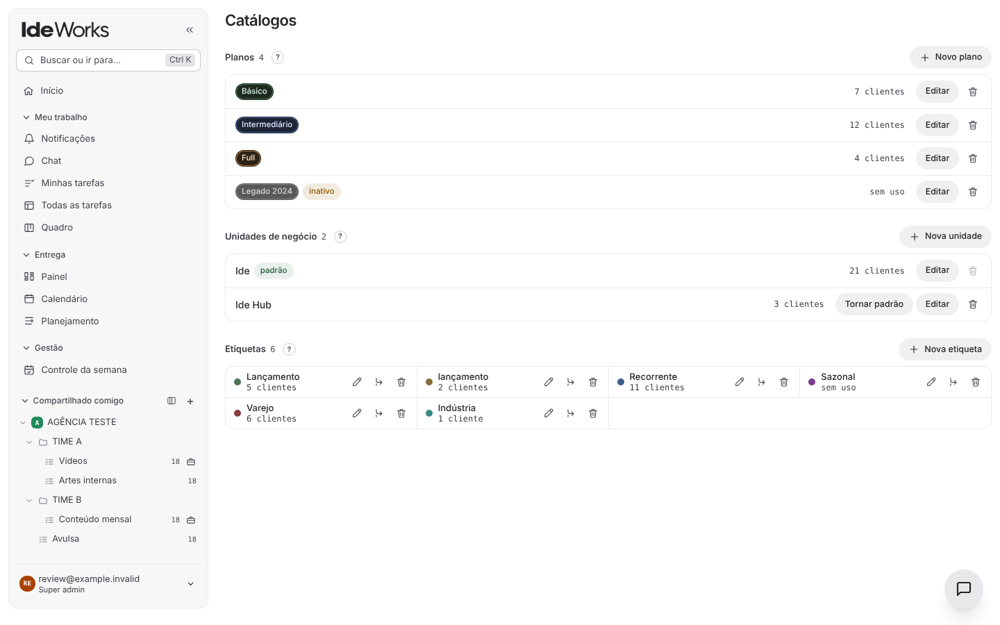

- **Planos** (ex.: Básico, Intermediário, Full): o pacote que cada cliente contrata.
- **Unidades de negócio**: as empresas do grupo. A primeira foi criada pelo
  `primeiro-acesso.sql`. Com mais de uma, cada pessoa e cada cliente pertencem a uma ou
  mais unidades, e cada um só vê o que é da sua.
- **Etiquetas**: marcadores livres para filtrar clientes (ex.: Varejo, Recorrente).

## 2. Clientes e o contrato do mês

No **Painel**, clique em **Novo cliente**. Depois, na ficha do cliente, defina o que ele
contrata por mês (quantos vídeos, artes, fotos e anúncios).

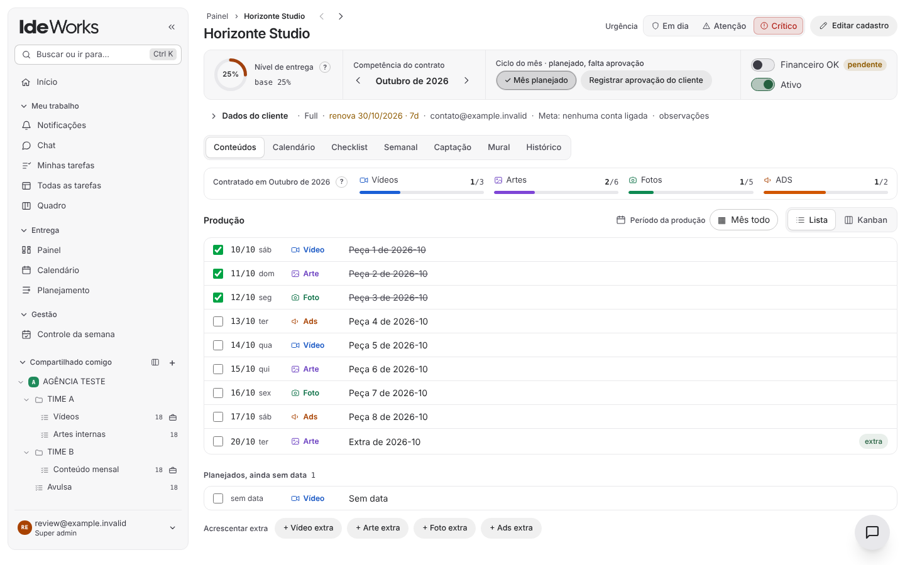

A ficha mostra:

- **Nível de entrega**: o quanto do contratado já foi entregue no mês.
- **Ciclo do mês**: abrir o mês, marcar como planejado e registrar a aprovação do cliente.
- **Abas**: Conteúdos (as peças do mês), Calendário, Checklist, Semanal, Captação, Mural e
  Histórico (reuniões, documentos e combinados).
- **Urgência** (Em dia, Atenção, Crítico) e **Financeiro OK**, marcados à mão pela gestão.

O **Painel** junta a carteira inteira: quem está crítico, quem renova em breve e a média de
entrega.

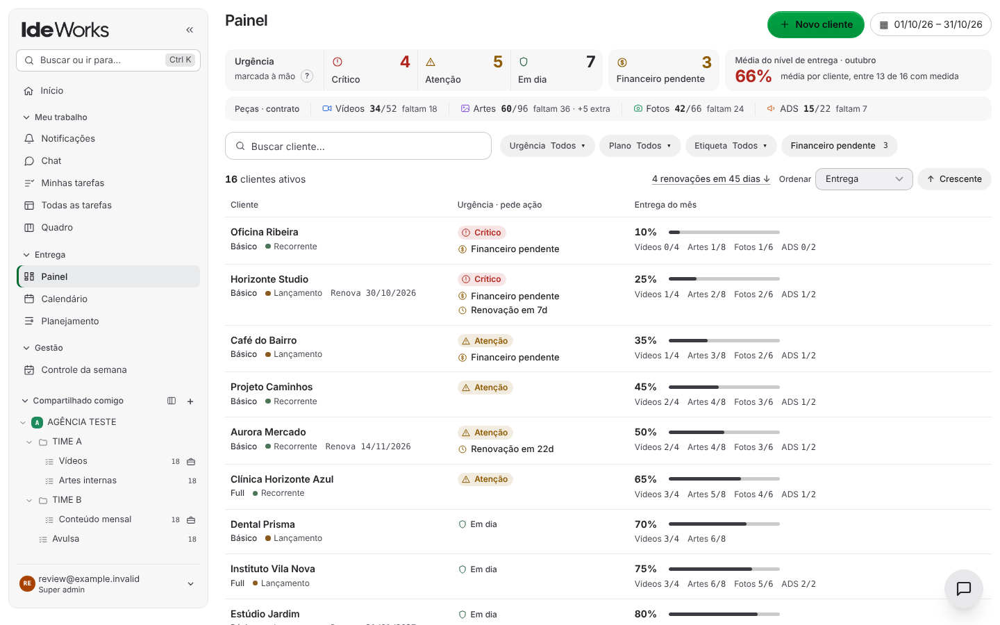

## 3. O quadro: espaços, pastas, listas e etapas

O quadro funciona como o ClickUp: **Espaço → Pasta → Lista → Tarefa**.

1. Na barra lateral, em **Compartilhado comigo**, use o **+** para criar um espaço
   (ex.: "Produção").
2. Dentro dele, crie pastas (ex.: um time) e listas (ex.: "Vídeos", "Artes").
3. Defina a **esteira** de cada espaço ou lista: as etapas por onde a tarefa passa
   (ex.: A fazer → Edição → Aprovação → Publicado). Lista sem esteira própria herda a do
   espaço.
4. Uma lista pode ficar **ligada a um cliente**: as tarefas dela contam na entrega dele.

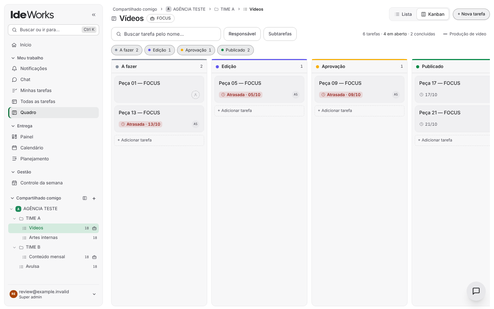

Cada lista abre em **Lista** ou **Kanban**. A tarefa tem responsáveis, prazo, prioridade,
etiquetas, tipo (Vídeo, Arte, Foto...), subtarefas, checklist, anexos e comentários com
menções (`@nome`).

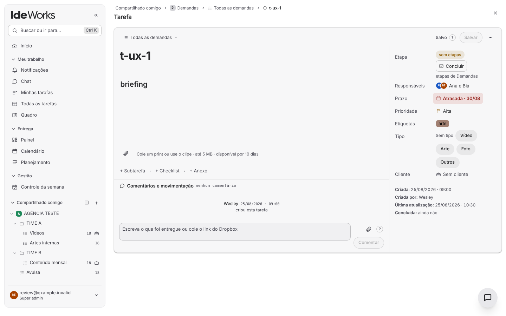

Também dá para criar **automações por etapa**: quando a tarefa chega numa etapa, ela vai
para outra lista ou ganha um responsável.

## 4. Convidar a equipe

Menu da conta → **Pessoas** → **Convidar alguém**.

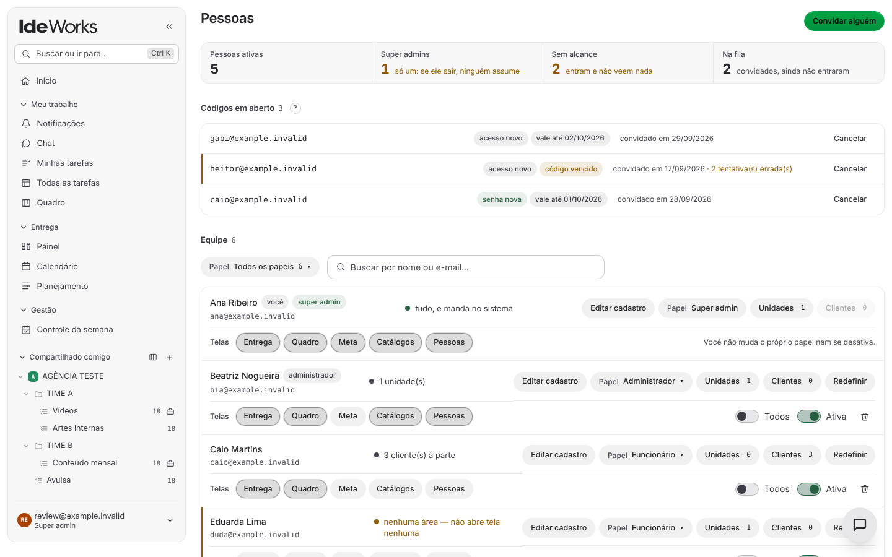

1. Informe o e-mail e escolha o papel:
   - **Super admin**: tudo, inclusive pessoas e catálogos.
   - **Administrador**: administra as unidades que tem.
   - **Funcionário**: trabalha nos clientes e listas que alcança.
2. O sistema gera um **código de ativação** (ex.: `ABC-DEF-GHJ`), válido por 72 horas, e um
   botão para copiar as instruções prontas. **Ele não manda e-mail**: você envia pelo
   WhatsApp ou como preferir.
3. A pessoa abre o sistema, clica em **Ativar conta**, informa e-mail, código e escolhe a
   própria senha.
4. Em **Telas**, você escolhe o que ela vê (Entrega, Quadro, Meta, Catálogos, Pessoas). Em
   **Clientes** e **Unidades**, até onde ela alcança.

Esqueceu a senha? Não existe "esqueci minha senha" por e-mail: um super admin clica em
**Redefinir** e entrega um código novo. Para tirar o acesso de alguém, desligue **Ativa**
(dá para religar depois). A lixeira tira a pessoa do IdeWorks, mas a conta de login dela
continua no Supabase: o sistema nunca apaga conta.

## 5. O dia a dia

| Tela | Para quê |
|---|---|
| **Minhas tarefas** | O que é seu: hoje, atrasado, próximo e sem prazo |
| **Todas as tarefas** | A fila de todo mundo, com filtros |
| **Notificações** | Menções, tarefas atribuídas e respostas de clientes |
| **Planejamento** | O mês de cada cliente: contrato, semanas e calendário |
| **Controle da semana** | A visão da gestão: quem planejou, quem entregou, o que está em risco ([guia](controle-da-semana.md)) |
| **Chat** | Conversas da equipe, em grupo ou diretas ([guia de menções](../mencoes-e-notificacoes.md)) |

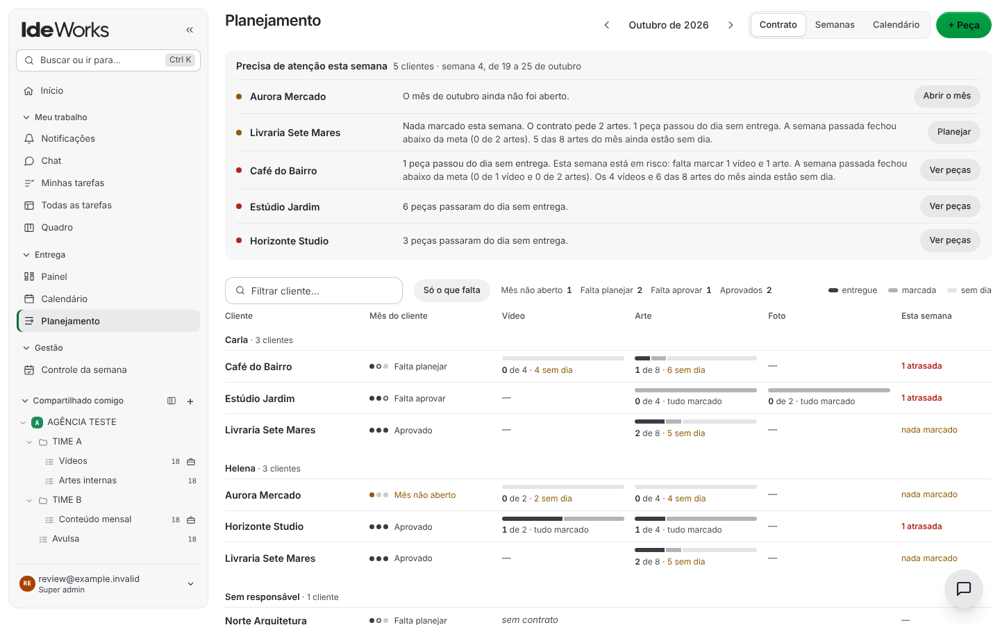

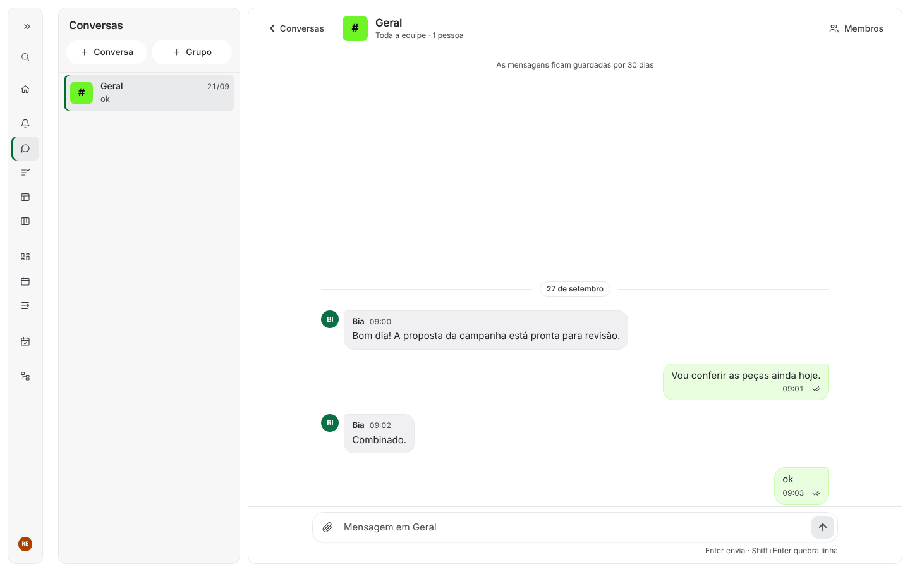

No celular, o sistema se ajusta à tela:

  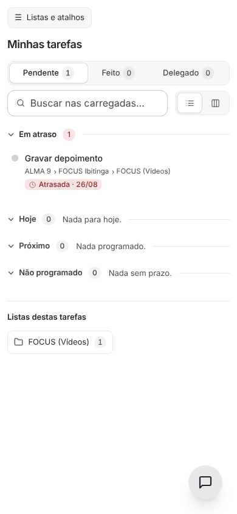
  &nbsp;
  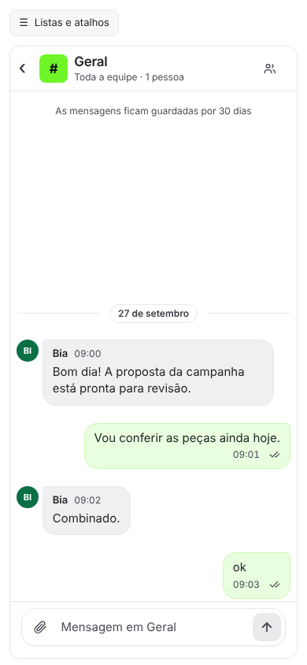

## 6. Aprovação do cliente

Cada cliente pode ter um **link fixo** em que ele vê os materiais e aprova ou pede ajuste,
pelo celular, sem criar conta. O guia completo está em
[Aprovação do cliente](aprovacao-do-cliente.md).

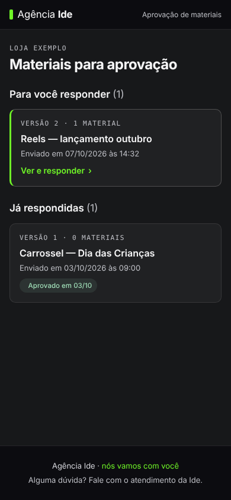

## 7. Meta e agentes de IA

Com as integrações configuradas ([tutorial 7](07-integracoes.md)):

- **Meta**: contas de Instagram e de anúncios ligadas a cada cliente, relatório por período
  e ranking.
- **Agentes de IA**: conecte o Claude, o ChatGPT ou uma automação. Eles leem e escrevem no
  sistema dentro das permissões que você der.

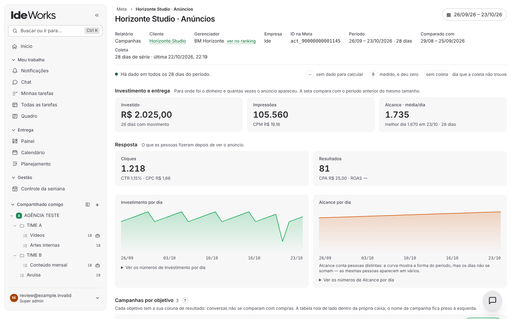

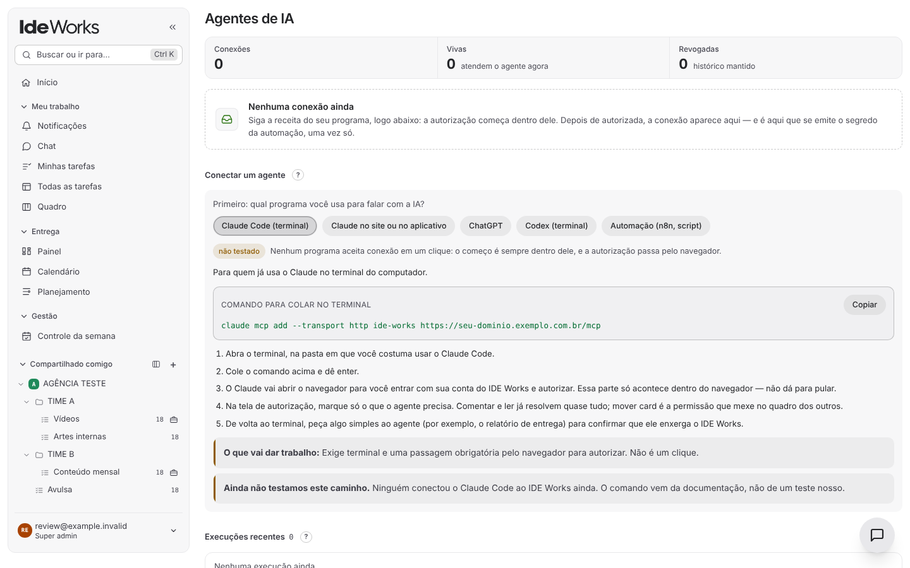

---

Anterior: [3. Rodar no computador](03-rodar-no-computador.md) ·
Próximo: [5. Publicar na Cloudflare](05-publicar-na-cloudflare.md)
